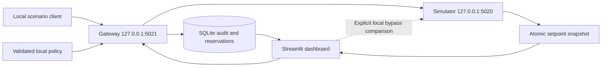

# Architecture — laboratory MVP 0.2

## Scope and components

X ColdShield demonstrates an application-aware Modbus TCP policy gateway. It runs only on loopback and implements a fixed synthetic register map. The simulator filename is retained from the original MVP; its behavior is not a vendor conformance implementation.

The `coldshield` package separates protocol handling, configuration, command policy, audit storage and laboratory utilities. `x_coldshield_proxy.py`, `danfoss_sim.py` and `attack_simulator.py` preserve the familiar entrypoints. The dashboard uses shared policy/client utilities and validates responses.

The runtime directory stores `audit.sqlite3` and `simulator_state.json`. The simulator writes an atomic snapshot with a UTC heartbeat. It records commanded setpoints and defrost flags; it does not model heat transfer, compressor behavior, product temperature or food spoilage.

## Protocol boundary

TCP is processed as a byte stream. Exact reads collect the seven-byte MBAP header, validate its protocol identifier and length, then read exactly the declared PDU bytes. Excess bytes remain in the socket for the next frame. Partial reads are accumulated until the declared size is reached. Incomplete frames are bounded by a deadline; invalid frames are not forwarded.

The application supports unit 1 and functions 03 and 06. Reads are permitted only over mapped contiguous register ranges. Function 06 requires an exact single-register request and a permitted address/value. Other functions, unknown registers and invalid encodings are refused. Temperature register values use signed 16-bit integers, with one integer representing one degree Celsius in this laboratory mapping. Defrost values are 0 or 1.

The framing design follows MBAP length semantics documented by the [Modbus Organization](https://www.modbus.org/modbus-specifications). Supporting this limited subset does not establish general Modbus conformance or industrial interoperability.

## Command flow

1. Accept a loopback client and collect one complete bounded frame.
2. Validate protocol/application shape, then reload and validate policy. Missing, malformed or invalid policy does not grant write access.
3. Assign a request identifier and evaluate function, unit, register, maintenance and value constraints.
4. Persist a decision expressing initial policy authorization before any upstream state query or forwarding. A pre-forward audit failure prevents forwarding.
5. For defrost starts, read simulator defrost registers and consult persistent start reservations while serializing command handling. Refuse another start when active state or a reservation prevents it; refuse if state cannot be verified. Recheck the write policy after blocking operations and again after connecting, immediately before sending FC06 bytes; a changed digest or expired window cancels the write.
6. Send with a deadline, validate the matching upstream response, and record the outcome under the same request identifier.
7. Return a valid response or an appropriate exception when the request is parseable. Transport failure or malformed framing can close the connection.

A permitted policy decision is not proof of application. An upstream timeout after send may mean a write applied but its reply was lost. Outcome records distinguish that uncertainty; the gateway does not automatically retry ambiguous writes.

## Configuration and maintenance

`policy_config.json` uses schema version 2. Fixed setpoint registers are 0, 1 and 2; fixed defrost registers are 10, 11 and 12. The default interval is -40°C through -15°C; configuration may narrow it but cannot extend it beyond those bounds. The original dashboard's adjustable limit up to 0°C is removed. This changes laboratory policy, not a validated physical safety envelope.

Maintenance starts disabled. The local maintenance command writes a bounded UTC interval of at most 900 seconds; a closed, expired or invalid interval refuses writes. Reads remain subject to the protocol/register allowlist. Configuration replacement is atomic. This authorizes a time interval, not a person: no contractor authentication is implemented.

## Defrost and restart behavior

The gateway checks simulated defrost flags before accepting a new start. It also stores a 120-second cooldown reservation so restart or an ambiguous downstream exchange does not immediately erase the recent-start constraint. Turning defrost off or resetting simulator state does not erase this cooldown. An active defrost flag continues preventing another start after cooldown expires. A reservation can conservatively block a command that never reached the simulator. Repeating a start for the already-active register is treated as an idempotent operation when no other register is active.

Host clocks, local storage and simulator state remain trusted inputs. Restart persistence depends on actual SQLite/filesystem durability. A POSIX file lock prevents another gateway from sharing the same runtime directory; current platform support is Linux/macOS. Shutdown drains active workers before releasing this lock. Independent runtime directories do not share reservations, so multiple gateways targeting one simulator are outside the demonstrated design. Direct simulator clients also bypass coordination and audit.

## Audit and operational limits

Structured records include UTC timestamps, request identifiers, decision reasons and policy SHA-256 digests. SQLite synchronous durability is requested. Records are not signed, externally anchored, remotely replicated or immutable. If a write occurs and subsequent outcome logging fails, the effect cannot be rolled back by the logger.

Connection deadlines and bounded client slots limit individual resource use. These are laboratory robustness controls, not a demonstrated denial-of-service defense. Performance, long-duration behavior, abrupt power loss and industrial availability remain open validation work.

See [SECURITY.md](SECURITY.md) for the trust model and [TEST_REPORT.md](TEST_REPORT.md) for collected evidence.
